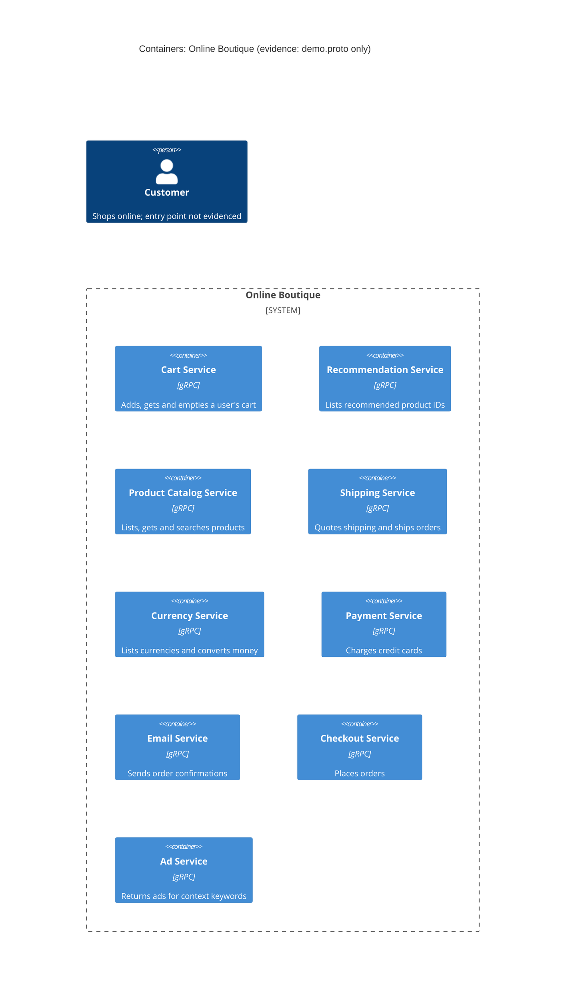

# Task 1 (run A): Recovered architecture — Online Boutique

## 1. Agent

Claude Code (Anthropic), model Claude Opus 5.5 (`claude-opus-5-5`).

## 2. Files read

- `prompts/1-recover-architecture.md` (task instructions)
- `system/online-boutique/protos/demo.proto` (the only evidence)

## 3. Containers table

The proto file defines gRPC service interfaces only. It shows **what each service offers**, not how it is implemented, so the implementation language is not evidenced for any service. (`option go_package` at line 19 only names the package for generated Go stubs; it says nothing about the language each service is written in.)

| Container | Technology / language | Responsibility (from RPCs) | Evidence |
|---|---|---|---|
| Cart Service | gRPC (proto3, package `hipstershop`); language not evidenced | Add items to a user's cart, get the cart, empty it (`AddItem`, `GetCart`, `EmptyCart`) | `system/online-boutique/protos/demo.proto` (`service CartService`, l.23–27) |
| Recommendation Service | gRPC; language not evidenced | Return recommended product IDs for a user and a list of products (`ListRecommendations`) | `demo.proto` (`service RecommendationService`, l.56–58) |
| Product Catalog Service | gRPC; language not evidenced | List, get and search products (`ListProducts`, `GetProduct`, `SearchProducts`) | `demo.proto` (`service ProductCatalogService`, l.71–75) |
| Shipping Service | gRPC; language not evidenced | Quote shipping cost and ship an order, returning a tracking ID (`GetQuote`, `ShipOrder`) | `demo.proto` (`service ShippingService`, l.107–110) |
| Currency Service | gRPC; language not evidenced | List supported currencies and convert money between currencies (`GetSupportedCurrencies`, `Convert`) | `demo.proto` (`service CurrencyService`, l.140–143) |
| Payment Service | gRPC; language not evidenced | Charge a credit card, returning a transaction ID (`Charge`) | `demo.proto` (`service PaymentService`, l.177–179) |
| Email Service | gRPC; language not evidenced | Send an order confirmation to an email address (`SendOrderConfirmation`) | `demo.proto` (`service EmailService`, l.199–201) |
| Checkout Service | gRPC; language not evidenced | Place an order for a user (address, email, card, currency) and return the order result (`PlaceOrder`) | `demo.proto` (`service CheckoutService`, l.224–226) |
| Ad Service | gRPC; language not evidenced | Return ads for a set of page context keywords (`GetAds`) | `demo.proto` (`service AdService`, l.243–245) |

Data stores: **none evidenced.** The proto defines no database or cache.

## 4. Dependencies table

| Caller → Callee | Protocol | Evidence |
|---|---|---|
| *None evidenced* | — | `demo.proto` declares the RPCs each service **provides**, but not which service **calls** which. No client configuration or call site is in the evidence. |

Candidate dependencies that the message types hint at are listed under **Gaps** as **[Inferred]**, not here.

## 5. Mermaid diagram

The diagram contains only what the tables contain: nine gRPC services and no `Rel` lines, because no runtime dependency is evidenced. The `Person` is shown because the diagram format requires it, but how the customer reaches the system is not evidenced (see Gaps).

## 6. Gaps

| Gap | What the proto suggests (if anything) | Which extra file would settle it |
|---|---|---|
| **Who calls whom** (all runtime dependencies) | **[Inferred]** `PlaceOrderRequest` (l.228–235) carries `user_id`, `address`, `email`, `credit_card` and `user_currency`, and `OrderResult` (l.208–214) holds a shipping tracking ID and cost. This fits Checkout calling Cart, Product Catalog, Currency, Shipping, Payment and Email, but the proto does not show it. | Service source code (e.g. `system/online-boutique/src/checkoutservice/`) or deployment config with service address variables (e.g. `system/online-boutique/kubernetes-manifests/checkoutservice.yaml`) |
| **Frontend / user entry point** | No frontend or web service is defined. Ad and Recommendation responses (page context keys, product IDs to show) suggest a UI consumer **[Inferred]**. | `system/online-boutique/kubernetes-manifests/frontend.yaml` (e.g. `CART_SERVICE_ADDR`) and the frontend source |
| **Customer → system protocol** (HTTP/HTTPS?) | Not evidenced. | Frontend deployment/service manifest |
| **Implementation language of each service** | Not evidenced (`go_package`, l.19, only concerns generated stubs). | Each service's source folder / `Dockerfile` under `system/online-boutique/src/` |
| **Data stores** (e.g. where carts are kept) | Cart state is keyed by `user_id` (`Cart`, l.47–50), so it must be stored somewhere **[Inferred]**; the store and its technology are not evidenced. | Cart service source and its deployment manifest (e.g. a cache/database manifest in `kubernetes-manifests/`) |
| **Product catalog data source** | Not evidenced (file, DB, or in-memory). | Product catalog service source |
| **External systems** (real payment provider, email/SMTP server) | `Charge` returns a `transaction_id` and `SendOrderConfirmation` takes an email address, but whether these call external systems or are mocks is not evidenced. | Payment and email service source code |
| **Any asynchronous messaging** (message broker) | None defined; all interfaces are unary gRPC RPCs. Absence of a broker is not proven by one proto file. | Full set of deployment manifests |
