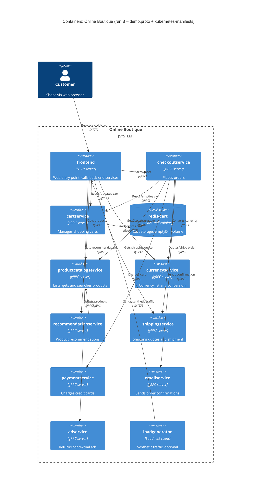

# Task 1 – Run B: Recovered C4 container architecture (Online Boutique)

## 1. Agent

- Product: Claude Code (Claude desktop app, Code tab)
- Model: Claude Opus 5.5 (`claude-opus-5-5`)

## 2. Files read

Task instructions: `AGENTS.md` (loaded via `CLAUDE.md`), `prompts/1-recover-architecture.md`.

Evidence:

- `system/online-boutique/protos/demo.proto`
- `system/online-boutique/kubernetes-manifests/README.md`
- `system/online-boutique/kubernetes-manifests/kustomization.yaml`
- `system/online-boutique/kubernetes-manifests/adservice.yaml`
- `system/online-boutique/kubernetes-manifests/cartservice.yaml`
- `system/online-boutique/kubernetes-manifests/checkoutservice.yaml`
- `system/online-boutique/kubernetes-manifests/currencyservice.yaml`
- `system/online-boutique/kubernetes-manifests/emailservice.yaml`
- `system/online-boutique/kubernetes-manifests/frontend.yaml`
- `system/online-boutique/kubernetes-manifests/loadgenerator.yaml`
- `system/online-boutique/kubernetes-manifests/paymentservice.yaml`
- `system/online-boutique/kubernetes-manifests/productcatalogservice.yaml`
- `system/online-boutique/kubernetes-manifests/recommendationservice.yaml`
- `system/online-boutique/kubernetes-manifests/shippingservice.yaml`

## 3. Containers table

Implementation language is **Not evidenced in the provided files** for every service: the manifests only give bare image names (e.g. `image: frontend`). The technology column therefore shows the protocol/runtime that *is* evidenced.

| Container | Technology | Responsibility | Evidence |
|---|---|---|---|
| `frontend` | HTTP server (port 8080); language not evidenced | Web entry point for shoppers; calls all user-facing back-end services | `kubernetes-manifests/frontend.yaml` (Service `frontend-external` type `LoadBalancer`, port `http` 80→8080; `httpGet /_healthz` probes; `*_SERVICE_ADDR` env vars) |
| `adservice` | gRPC server (port 9555); language not evidenced | Returns text ads for given context keywords (`AdService.GetAds`) | `protos/demo.proto` (`service AdService`); `kubernetes-manifests/adservice.yaml` (Service port `grpc` 9555, `grpc` probes) |
| `cartservice` | gRPC server (port 7070); language not evidenced | Stores and returns a user's shopping cart (`AddItem`, `GetCart`, `EmptyCart`) | `protos/demo.proto` (`service CartService`); `kubernetes-manifests/cartservice.yaml` (Service port `grpc` 7070, `REDIS_ADDR`) |
| `checkoutservice` | gRPC server (port 5050); language not evidenced | Places an order (`PlaceOrder`) and returns an `OrderResult` (order id, tracking id, shipping cost, items) | `protos/demo.proto` (`service CheckoutService`, `message OrderResult`); `kubernetes-manifests/checkoutservice.yaml` (Service port `grpc` 5050) |
| `currencyservice` | gRPC server (port 7000); language not evidenced | Lists supported currencies and converts `Money` between ISO 4217 codes | `protos/demo.proto` (`service CurrencyService`: `GetSupportedCurrencies`, `Convert`); `kubernetes-manifests/currencyservice.yaml` (Service port `grpc` 7000) |
| `emailservice` | gRPC server (Service port 5000 → container 8080); language not evidenced | Sends order confirmation for an order (`SendOrderConfirmation`) | `protos/demo.proto` (`service EmailService`); `kubernetes-manifests/emailservice.yaml` (Service port `grpc` 5000, `targetPort: 8080`) |
| `paymentservice` | gRPC server (port 50051); language not evidenced | Charges a credit card for an amount and returns a transaction id (`Charge`) | `protos/demo.proto` (`service PaymentService`, `message CreditCardInfo`); `kubernetes-manifests/paymentservice.yaml` (Service port `grpc` 50051) |
| `productcatalogservice` | gRPC server (port 3550); language not evidenced | Lists, gets and searches products (`ListProducts`, `GetProduct`, `SearchProducts`) | `protos/demo.proto` (`service ProductCatalogService`); `kubernetes-manifests/productcatalogservice.yaml` (Service port `grpc` 3550) |
| `recommendationservice` | gRPC server (port 8080); language not evidenced | Returns recommended product ids for a user and product list (`ListRecommendations`) | `protos/demo.proto` (`service RecommendationService`); `kubernetes-manifests/recommendationservice.yaml` (Service port `grpc` 8080) |
| `shippingservice` | gRPC server (port 50051); language not evidenced | Quotes shipping cost and ships an order, returning a tracking id (`GetQuote`, `ShipOrder`) | `protos/demo.proto` (`service ShippingService`); `kubernetes-manifests/shippingservice.yaml` (Service port `grpc` 50051) |
| `redis-cart` (data store) | Redis (`redis:alpine`), port 6379; data on `emptyDir` volume (non-persistent) | Cart storage for `cartservice` | `kubernetes-manifests/cartservice.yaml` (Deployment/Service `redis-cart`, `image: redis:alpine`, `volumes: redis-data emptyDir`) |
| `loadgenerator` | Container image `loadgenerator`; language not evidenced | Synthetic traffic generator against the frontend (`USERS=10`, `RATE=1`). Not in the default kustomization (commented out). | `kubernetes-manifests/loadgenerator.yaml` (`FRONTEND_ADDR`); `kubernetes-manifests/kustomization.yaml` (`# - loadgenerator.yaml`) |

## 4. Dependencies table

Protocol evidence for gRPC edges: the **callee's** Kubernetes Service port is named `grpc` and its probes are `grpc:`, and the callee implements a `service` in `demo.proto`. The caller side only shows the address (`host:port`) in an env var.

| # | Caller → Callee | Protocol | Evidence |
|---|---|---|---|
| 1 | Customer → `frontend` | HTTP | `kubernetes-manifests/frontend.yaml` (Service `frontend-external`, `type: LoadBalancer`, port name `http` 80→8080) |
| 2 | `loadgenerator` → `frontend` | HTTP | `kubernetes-manifests/loadgenerator.yaml` (`FRONTEND_ADDR=frontend:80`; init container `wget http://${FRONTEND_ADDR}`) |
| 3 | `frontend` → `productcatalogservice` | gRPC | `kubernetes-manifests/frontend.yaml` (`PRODUCT_CATALOG_SERVICE_ADDR=productcatalogservice:3550`) |
| 4 | `frontend` → `currencyservice` | gRPC | `kubernetes-manifests/frontend.yaml` (`CURRENCY_SERVICE_ADDR=currencyservice:7000`) |
| 5 | `frontend` → `cartservice` | gRPC | `kubernetes-manifests/frontend.yaml` (`CART_SERVICE_ADDR=cartservice:7070`) |
| 6 | `frontend` → `recommendationservice` | gRPC | `kubernetes-manifests/frontend.yaml` (`RECOMMENDATION_SERVICE_ADDR=recommendationservice:8080`) |
| 7 | `frontend` → `shippingservice` | gRPC | `kubernetes-manifests/frontend.yaml` (`SHIPPING_SERVICE_ADDR=shippingservice:50051`) |
| 8 | `frontend` → `checkoutservice` | gRPC | `kubernetes-manifests/frontend.yaml` (`CHECKOUT_SERVICE_ADDR=checkoutservice:5050`) |
| 9 | `frontend` → `adservice` | gRPC | `kubernetes-manifests/frontend.yaml` (`AD_SERVICE_ADDR=adservice:9555`) |
| 10 | `checkoutservice` → `productcatalogservice` | gRPC | `kubernetes-manifests/checkoutservice.yaml` (`PRODUCT_CATALOG_SERVICE_ADDR=productcatalogservice:3550`) |
| 11 | `checkoutservice` → `shippingservice` | gRPC | `kubernetes-manifests/checkoutservice.yaml` (`SHIPPING_SERVICE_ADDR=shippingservice:50051`) |
| 12 | `checkoutservice` → `paymentservice` | gRPC | `kubernetes-manifests/checkoutservice.yaml` (`PAYMENT_SERVICE_ADDR=paymentservice:50051`) |
| 13 | `checkoutservice` → `emailservice` | gRPC | `kubernetes-manifests/checkoutservice.yaml` (`EMAIL_SERVICE_ADDR=emailservice:5000`) |
| 14 | `checkoutservice` → `currencyservice` | gRPC | `kubernetes-manifests/checkoutservice.yaml` (`CURRENCY_SERVICE_ADDR=currencyservice:7000`) |
| 15 | `checkoutservice` → `cartservice` | gRPC | `kubernetes-manifests/checkoutservice.yaml` (`CART_SERVICE_ADDR=cartservice:7070`) |
| 16 | `recommendationservice` → `productcatalogservice` | gRPC | `kubernetes-manifests/recommendationservice.yaml` (`PRODUCT_CATALOG_SERVICE_ADDR=productcatalogservice:3550`) |
| 17 | `cartservice` → `redis-cart` | Redis protocol over TCP | `kubernetes-manifests/cartservice.yaml` (`REDIS_ADDR=redis-cart:6379`; Service port name `tcp-redis`) |

Services with **no outbound dependency** in the manifests: `adservice`, `currencyservice`, `emailservice`, `paymentservice`, `productcatalogservice`, `shippingservice` (no `*_ADDR` env vars).

## 5. Mermaid diagram

Note: the `Rel` labels describe the purpose suggested by the callee's RPCs in `demo.proto`. **[Inferred]** Which RPCs each caller actually invokes is not shown by the evidence (see Gaps).

## 6. Gaps

| Gap | What the evidence shows | File(s) that would settle it |
|---|---|---|
| Implementation language/framework of each service | Only bare image names (`image: cartservice`, …) | Each service's source folder and `Dockerfile` (e.g. under `system/online-boutique/src/`) |
| Which RPCs each caller uses (e.g. does `checkoutservice` call `GetCart` and `EmptyCart`; does `frontend` call `ShippingService.GetQuote`) | Callers only have `*_SERVICE_ADDR` env vars; `demo.proto` defines services but not callers | Caller source code (`frontend`, `checkoutservice`, `recommendationservice`) |
| `shoppingassistantservice` | `frontend.yaml` sets `SHOPPING_ASSISTANT_SERVICE_ADDR=shoppingassistantservice:80` (and `ENABLE_ASSISTANT` is commented out), but there is no manifest or proto service for it; `kustomization.yaml` has it as a commented-out component (`../kustomize/components/shopping-assistant`) | `system/online-boutique/kustomize/components/shopping-assistant/` and frontend source. Excluded from the diagram. |
| "Packaging service" | Only a commented-out `PACKAGING_SERVICE_URL` in `frontend.yaml` | Frontend source / optional Google Cloud demo docs. Excluded from the diagram. |
| Where `productcatalogservice` gets its product data | No data store, volume or DB env var in `productcatalogservice.yaml` | `productcatalogservice` source (e.g. a bundled products file) |
| Alternative data stores | `kustomization.yaml` lists commented-out components `memorystore`, `alloydb`, `spanner` | `system/online-boutique/kustomize/components/{memorystore,alloydb,spanner}/` |
| External systems (real payment gateway, SMTP/email provider) | `paymentservice` and `emailservice` have no outbound addresses/URLs; no `System_Ext` can be proven | `paymentservice` and `emailservice` source code |
| Durability of cart data | `redis-cart` uses an `emptyDir` volume, so data lives only as long as the pod **[Inferred: carts are lost on pod rescheduling]** | Redis configuration / `cartservice` source |
| Transport security (TLS/mTLS) on gRPC and HTTP | No TLS settings in manifests; `sidecar.istio.io/rewriteAppHTTPProbers` annotation hints at optional Istio | Service-mesh / network-policy configs (e.g. `kustomize/components/network-policies/`, Istio manifests) |
| Synchronous vs asynchronous interaction | All edges are address-based request/response endpoints; no message broker appears | Caller source code (to confirm no async calls or queues) |
| Image tags / deployed versions | `README.md` says these manifests need `skaffold` to insert tags and points to `/release` | `skaffold.yaml` and `system/online-boutique/release/` manifests |
