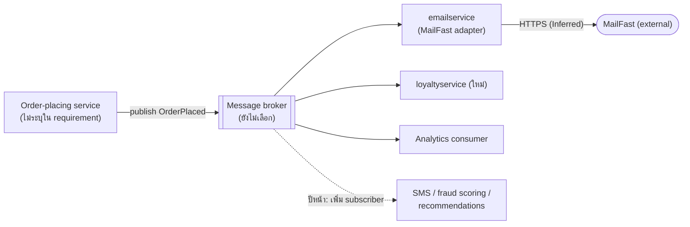

> Agent: Claude Code · Model: Claude Opus 5.5 (`claude-opus-5-5`) · Run: a (zero-shot, `context: none`)

# ADR-0002: ใช้ event "OrderPlaced" แบบ publish/subscribe สำหรับงานหลังสั่งซื้อ

- **Status:** Proposed
- **Date:** 2026-10-27
- **Deciders:** ไม่ได้ระบุใน requirement (ดู **Open questions**)

## Context and problem

requirement ใหม่กำหนดว่า หลังจากลูกค้าสั่งซื้อ (order placed) สำเร็จ Online Boutique ต้องทำงานต่อไปนี้:

| # | งานหลังสั่งซื้อ | ปลายทาง | สถานะปัจจุบัน |
|---|---|---|---|
| 1 | ส่งอีเมลยืนยันคำสั่งซื้อ | **MailFast** (external email provider รายใหม่) | แทนที่ logic จำลอง (mock) ใน `emailservice` |
| 2 | ให้ **loyalty points** | `loyaltyservice` (ยังไม่มี ต้องสร้างใหม่) | ใหม่ |
| 3 | บันทึก analytics event "order placed" ให้ทีม marketing | ระบบ analytics (ไม่ได้ระบุว่าเป็นระบบใด) | ใหม่ |

แรงกดดันหลัก:

- **จำนวนงานหลังสั่งซื้อจะเพิ่มขึ้น:** marketing คาดว่าปีหน้าจะมีงานเพิ่ม (SMS, fraud scoring, การอัปเดต recommendations) ดังนั้นการเพิ่มงานใหม่ต้องไม่กระทบ flow การสั่งซื้อทุกครั้ง
- **มี external dependency ใหม่ (MailFast):** ระบบภายนอกอาจช้า ล่ม หรือจำกัด rate ได้ ซึ่งไม่ควรทำให้การสั่งซื้อล้มเหลว **[Inferred]**
- **ปัญหาที่ต้องตัดสินใจ:** service ที่รับผิดชอบการสั่งซื้อควรสั่งงานหลังสั่งซื้อเหล่านี้อย่างไร (เรียกตรงแบบ synchronous, ผ่าน event แบบ asynchronous, หรือผ่าน orchestrator)

ข้อจำกัดของ ADR นี้: เขียนจาก requirement เพียงอย่างเดียว ไม่ได้อ่าน code ของระบบ ดังนั้นรายละเอียดเช่น service ใดเป็นผู้ place order, protocol ระหว่าง service ที่ใช้อยู่ และการมี/ไม่มี message broker ในระบบปัจจุบัน — Not evidenced in the provided files

## Decision drivers

เรียงจากสำคัญที่สุด (ลำดับนี้เป็น **[Inferred]** จาก requirement เพราะไม่มี quality goal ที่ระบุเป็นตัวเลข):

- **Modifiability / extensibility:** เพิ่มงานหลังสั่งซื้อใหม่ (SMS, fraud scoring, recommendations) ได้โดยไม่ต้องแก้ service ที่ place order
- **Availability ของ flow การสั่งซื้อ:** ความล้มเหลวของ MailFast, `loyaltyservice` หรือ analytics ต้องไม่ทำให้การสั่งซื้อล้มเหลว
- **Performance (latency ของการสั่งซื้อ):** ลูกค้าไม่ควรต้องรอให้งานหลังสั่งซื้อทุกงานเสร็จก่อนได้รับผลลัพธ์
- **Reliability ของแต่ละงาน:** อีเมลและ loyalty points ไม่ควรหายเมื่อปลายทางล่มชั่วคราว (ต้อง retry ได้) และไม่ควรให้ points ซ้ำ
- **Operability / cost:** จำนวน infrastructure ใหม่ที่ทีมต้องดูแล
- **Isolation จาก external provider:** เปลี่ยน email provider ในอนาคตได้โดยแก้เฉพาะจุดเดียว

## Considered options

1. **Option A — Synchronous orchestration:** service ที่ place order เรียก MailFast (ผ่าน `emailservice`), `loyaltyservice` และ analytics ตรง ๆ ทีละตัวภายใน request การสั่งซื้อ
2. **Option B — Event-driven publish/subscribe:** service ที่ place order publish event `OrderPlaced` เพียงครั้งเดียวไปยัง message broker แต่ละงานหลังสั่งซื้อเป็น subscriber อิสระ (`emailservice` → MailFast, `loyaltyservice`, analytics consumer)
3. **Option C — Dedicated post-order orchestrator:** service ที่ place order ส่งคำขอเดียว (async) ไปยัง `postorderservice` ใหม่ ซึ่งเป็นผู้เรียกงานแต่ละงานตามลำดับ พร้อม retry และเก็บสถานะ (workflow/saga orchestration)

### Pros and cons of the options

| Option | Pros | Cons |
|---|---|---|
| A — Synchronous orchestration | • เรียบง่าย ไม่ต้องมี infrastructure ใหม่ • ตามรอย (trace) และ debug ง่าย เพราะอยู่ใน request เดียว • รู้ผลทันทีว่าแต่ละงานสำเร็จหรือไม่ | • latency ของการสั่งซื้อ = ผลรวมของทุกงาน และเพิ่มขึ้นทุกครั้งที่เพิ่มงาน (performance) • MailFast หรือ service ใดล่ม ทำให้การสั่งซื้อช้าหรือล้มเหลว (availability) • ทุกงานใหม่ปีหน้าต้องแก้ service ที่ place order (modifiability) • ต้องเขียน retry/timeout เองในที่เดียวที่สำคัญที่สุด |
| B — Event-driven pub/sub | • service ที่ place order ไม่รู้จัก consumer — เพิ่ม SMS / fraud scoring / recommendations ได้โดยเพิ่ม subscriber ใหม่ (modifiability) • งานหลังสั่งซื้อล้มเหลวไม่กระทบการสั่งซื้อ (availability) • latency ของการสั่งซื้อเพิ่มแค่การ publish ครั้งเดียว (performance) • แต่ละ consumer retry และ scale ได้อิสระ • broker ช่วยรองรับ burst และ rate limit ของ MailFast | • ต้องมีและดูแล message broker ใหม่ (operability, cost) • eventual consistency: อีเมล/points มาถึงช้ากว่าการสั่งซื้อ • ต้องจัดการ duplicate delivery (idempotency) และ dead-letter queue • ภาพรวม flow ไม่อยู่ในที่เดียว ต้องใช้ distributed tracing และ monitoring • ต้องตกลง schema ของ event และ versioning |
| C — Post-order orchestrator | • แยกงานหลังสั่งซื้อออกจาก flow การสั่งซื้อ (availability, performance) • ลำดับงานและสถานะอยู่ในที่เดียว เห็นภาพรวมง่าย • รองรับงานที่มีลำดับหรือเงื่อนไข เช่น fraud scoring ต้องผ่านก่อนให้ points **[Inferred]** | • orchestrator ต้องแก้ทุกครั้งที่เพิ่มงานใหม่ → กลายเป็นจุดที่ coupling สูง (modifiability) • เป็น service ใหม่ที่ต้องมี state store และ HA ของตัวเอง (cost, availability) • ยังต้องมีช่องทาง async ระหว่าง service ที่ place order กับ orchestrator อยู่ดี • ซับซ้อนเกินความจำเป็นหากงานส่วนใหญ่เป็นอิสระต่อกัน |

## Decision

เลือก **Option B — Event-driven publish/subscribe** โดยมีรายละเอียดดังนี้:

- service ที่ place order publish event `OrderPlaced` (เช่น order id, user id, email, รายการสินค้า, ยอดรวม) หนึ่งครั้งหลังการสั่งซื้อสำเร็จ
- **`emailservice`** subscribe event แล้วเรียก MailFast ผ่าน adapter (แทน mock logic เดิม) — การผูกกับ MailFast อยู่ใน service นี้เท่านั้น
- **`loyaltyservice`** (ใหม่) subscribe event แล้วให้ points แบบ idempotent (ใช้ order id เป็น key กันการให้ซ้ำ)
- **analytics consumer** subscribe event แล้วส่งต่อให้ระบบ analytics ของ marketing
- ใช้ retry with backoff และ dead-letter queue ในแต่ละ subscription
- ยังไม่เลือกผลิตภัณฑ์ broker (เช่น RabbitMQ, Kafka หรือ managed pub/sub ของ cloud) จนกว่าจะได้คำตอบใน **Open questions**

เหตุผล: driver อันดับแรกคือ modifiability เพราะ marketing ระบุชัดว่าจะมีงานหลังสั่งซื้อเพิ่ม Option B เป็นทางเลือกเดียวที่เพิ่มงานใหม่ได้โดยไม่แก้ทั้ง service ที่ place order และ orchestrator กลาง ขณะเดียวกันก็แยกความล้มเหลวของ MailFast ออกจากการสั่งซื้อ (availability) และไม่เพิ่ม latency ตามจำนวนงาน (performance) ส่วน Option C จะคุ้มกว่าก็ต่อเมื่องานในอนาคตมีลำดับบังคับ (เช่น fraud scoring ต้องผ่านก่อน) ซึ่งยังไม่ evidenced ใน requirement

## Consequences

- **Positive:** เพิ่มงานหลังสั่งซื้อใหม่ได้โดยเพิ่ม subscriber โดยไม่แก้ service ที่ place order (quality attribute: modifiability)
- **Positive:** MailFast, `loyaltyservice` หรือ analytics ล่ม ไม่ทำให้การสั่งซื้อล้มเหลว event รอใน broker จนกว่า consumer จะกลับมา (quality attribute: availability)
- **Positive:** latency ของการสั่งซื้อไม่เพิ่มตามจำนวนงานหลังสั่งซื้อ (quality attribute: performance)
- **Positive:** การผูกกับ MailFast อยู่ใน `emailservice` เท่านั้น เปลี่ยน provider ได้ในจุดเดียว (quality attribute: modifiability)
- **Positive:** แต่ละ consumer scale แยกกันได้ และ broker ช่วยรับ burst ของคำสั่งซื้อ (quality attribute: scalability)
- **Negative:** ต้องติดตั้ง ดูแล และ monitor message broker ใหม่ (quality attribute: cost, operability)
- **Negative:** อีเมลและ points เป็น eventual consistency — ลูกค้าอาจเห็น points ช้ากว่าคำสั่งซื้อ (quality attribute: consistency / usability)
- **Negative:** debug flow ข้าม service ยากขึ้น ต้องมี correlation id และ distributed tracing (quality attribute: testability, observability)
- **Risks and mitigations:**
  - *publish event หายเมื่อ service ล่มหลังบันทึกคำสั่งซื้อแต่ก่อน publish* → ใช้ transactional outbox หรือ publish พร้อม retry (ขึ้นกับว่ามีการบันทึกคำสั่งซื้อที่ใด — ดู Open questions)
  - *duplicate delivery ทำให้ส่งอีเมลซ้ำหรือให้ points ซ้ำ* → consumer ต้อง idempotent โดยใช้ order id เป็น deduplication key
  - *MailFast จำกัด rate หรือล่มนาน* → retry with exponential backoff, dead-letter queue และ alert
  - *schema ของ event เปลี่ยนแล้วทำให้ consumer พัง* → กำหนด schema และ versioning ตั้งแต่แรก (เช่น เพิ่มได้เฉพาะ field แบบ optional)
  - *event มีข้อมูลส่วนบุคคล (email) ไปถึง consumer ทุกตัว รวมถึง analytics* → ส่งเฉพาะ field ที่จำเป็น หรือให้ analytics ได้ข้อมูลที่ไม่ระบุตัวตน **[Inferred]**

## Validation

- **Load test:** วัด latency ของการสั่งซื้อก่อน/หลังเพิ่มการ publish event — เป้าหมายตัวเลขยังไม่ได้กำหนด (ดู Open questions)
- **Fault-injection test:** ปิด MailFast (หรือ stub ที่ตอบ error/timeout), `loyaltyservice` และ analytics consumer แล้วยืนยันว่าการสั่งซื้อยังสำเร็จ และงานค้างถูกประมวลผลครบเมื่อกลับมา
- **Idempotency test:** ส่ง event `OrderPlaced` เดิมซ้ำ แล้วยืนยันว่าส่งอีเมลหนึ่งฉบับและให้ points ครั้งเดียว
- **Metrics:** อัตราความสำเร็จของการส่งอีเมล, ความยาว queue / consumer lag, จำนวน message ใน dead-letter queue, เวลาจาก order placed ถึงส่งอีเมล
- **Modifiability check:** เมื่อเพิ่มงานแรกของปีหน้า (เช่น SMS) ให้ยืนยันว่าไม่ต้องแก้ service ที่ place order
- **Review date:** ทบทวน ADR นี้ก่อนเริ่มทำ fraud scoring เพราะอาจต้องการลำดับงานแบบ Option C — วันที่ยังไม่กำหนด

## Open questions

ข้อมูลต่อไปนี้ไม่ได้ให้มาใน requirement และไม่ได้คาดเดาแทน:

1. **Deciders:** ใครเป็นผู้ตัดสินใจ / อนุมัติ ADR นี้?
2. **Order-placing service:** service ใดใน Online Boutique เป็นผู้ place order และปัจจุบันเรียก `emailservice` อย่างไร (protocol, sync/async)? — Not evidenced in the provided files
3. **Broker ที่มีอยู่:** ระบบมี message broker อยู่แล้วหรือไม่ และ platform/cloud ที่ใช้ deploy คืออะไร? (มีผลต่อการเลือก RabbitMQ / Kafka / managed pub/sub)
4. **Team skills:** ทีมมีประสบการณ์กับ message broker และ event-driven design หรือไม่?
5. **ปริมาณและ quality goals:** จำนวนคำสั่งซื้อต่อวินาที (ปกติและ peak), เป้าหมาย latency ของการสั่งซื้อ, availability target
6. **ความเร็วที่ยอมรับได้:** อีเมลยืนยันต้องถึงลูกค้าภายในกี่วินาที/นาที? points ต้องแสดงทันทีหรือไม่?
7. **MailFast:** API (REST/SMTP), rate limit, SLA, ราคาต่อฉบับ, รองรับ idempotency key หรือไม่, และสัญญา/ข้อกำหนดด้าน data residency
8. **Loyalty rules:** สูตรคำนวณ points, การหัก points เมื่อยกเลิก/คืนสินค้า, และ `loyaltyservice` ต้องมี data store แบบใด
9. **Analytics:** ระบบปลายทางของ marketing คืออะไร (warehouse, third-party tool) และต้องการ field ใดบ้าง
10. **การบันทึกคำสั่งซื้อ:** ระบบเก็บคำสั่งซื้อไว้ใน data store หรือไม่ (จำเป็นต่อการทำ transactional outbox)?
11. **ข้อกำหนดด้าน privacy/compliance:** ข้อจำกัดในการส่งข้อมูลส่วนบุคคลไปยัง MailFast และ analytics
12. **งานในอนาคต:** fraud scoring ต้อง block การสั่งซื้อหรือ block การให้ points หรือไม่? (ถ้าใช่ อาจต้องใช้ synchronous call หรือ Option C สำหรับงานนั้น)
13. **Budget:** งบประมาณสำหรับ infrastructure ใหม่ (broker) และค่าบริการ MailFast
