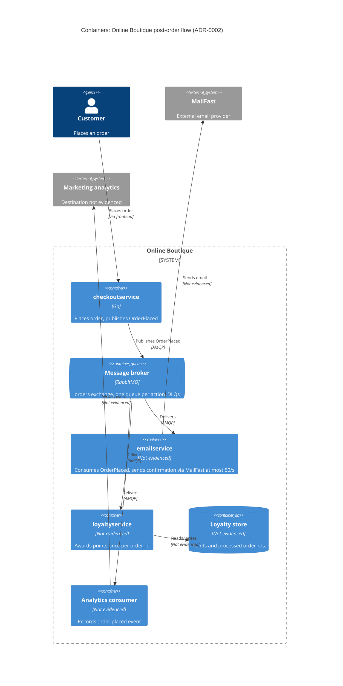

> Agent: Claude Code — Model: Claude Opus 5.5 (`claude-opus-5-5`)

# ADR-0002: ใช้ RabbitMQ กระจาย event `OrderPlaced` ไปยัง post-order actions แบบ asynchronous

- **Status:** Proposed
- **Date:** 2026-10-27
- **Deciders:** ยังไม่ระบุ (Not evidenced in the provided files) — ดู Open questions

## Context and problem

Requirement R-12 (`docs/scenario.md`) กำหนดว่าหลังสั่งซื้อสำเร็จ ระบบต้อง (1) ส่งอีเมลยืนยันผ่าน **MailFast** แทน logic จำลองใน `emailservice` (2) ให้ **loyalty points** ผ่าน `loyaltyservice` ตัวใหม่ (3) บันทึก **analytics event "order placed"** และฝ่ายการตลาดคาดว่าปีหน้าจะมี post-order actions เพิ่ม (SMS, fraud scoring, recommendations update)

**สภาพปัจจุบัน (จากโค้ด):**

| ข้อเท็จจริง | หลักฐาน |
|---|---|
| `PlaceOrder` เรียก `chargeCard` → `shipOrder` → `emptyUserCart` → `sendOrderConfirmation` ตามลำดับแบบ synchronous | `system/online-boutique/src/checkoutservice/main.go:252-277` (`PlaceOrder`) |
| ถ้าส่งอีเมลล้มเหลว จะแค่ log warning และ order ยังสำเร็จ | `main.go:273-277` |
| การเรียก `emailservice` ใช้ `ctx` ของ request โดยไม่มี timeout แยก → อีเมลที่ช้าจะทำให้ `PlaceOrder` ช้าตาม | `main.go:379-384` (`sendOrderConfirmation`) |
| `checkoutservice` ผูกกับ `emailservice` ผ่าน env `EMAIL_SERVICE_ADDR` และ gRPC connection | `main.go:115`, `main.go:122` |
| `orderID` สร้างใน `checkoutservice` (UUID) → ใช้เป็น idempotency key ได้ | `main.go:233` |
| ยอดรวม `total` คำนวณใน `PlaceOrder` แต่ **ไม่ได้อยู่ใน** `OrderResult` ที่ส่งให้อีเมล | `main.go:243-250` vs `main.go:265-271` |
| `checkoutservice` ไม่มี data store ของตัวเอง | Not evidenced in the provided files ว่ามี DB (ไม่มี connection ใดนอกจาก gRPC ใน `main.go:111-123`) |

**ตัวเลขที่บังคับการตัดสินใจ** (`docs/scenario.md`, ตาราง Quality goals and constraints):

- `PlaceOrder` p95 ต้อง **≤ 500 ms** (ปัจจุบัน ~300 ms) → เหลืองบ ~200 ms
- MailFast p95 **1.5 s**, p99 **8 s** → ถ้าเรียกแบบ synchronous จะเกินงบทันที (300 ms + 1.5 s ≫ 500 ms)
- Peak **200 orders/s** แต่ MailFast rate limit **50 emails/s** → ช่วง peak เกิด backlog อีเมล ~150 ฉบับ/วินาที ซึ่งต้องมีที่พักข้อมูล (buffer)
- MailFast ล้มเหลว ~**0.5 %** → ที่ 200 orders/s คือ ~1 ครั้ง/วินาที ต้องมี retry
- Loyalty points ต้องให้ **ภายใน 1 นาที** และ **exactly once**
- Order ต้อง **ไม่ล้มเหลว** เพราะ email, loyalty หรือ analytics ล่ม
- ทีม 4 คน เก่ง Go/gRPC, 2 คนเคยใช้ **RabbitMQ**; ทุกอย่างรันบน Kubernetes; องค์กรเลือก **open-source, self-hosted**

**ปัญหา:** `checkoutservice` ควรสั่งงาน post-order actions อย่างไร ให้ไม่กระทบ latency และ availability ของ checkout, เคารพ rate limit ของ MailFast, ให้ loyalty points แบบ exactly once และเพิ่ม action ใหม่ได้โดยไม่ต้องแก้ `checkoutservice` ทุกครั้ง

## Decision drivers

1. **Availability:** order ต้องสำเร็จแม้ MailFast, `loyaltyservice` หรือ analytics ล่ม
2. **Performance (latency):** `PlaceOrder` p95 ≤ 500 ms ที่ 200 orders/s
3. **Reliability / correctness:** loyalty points exactly once ภายใน 1 นาที; อีเมลต้องไม่หายเมื่อ MailFast ล้มเหลว 0.5 % หรือติด rate limit 50/s
4. **Modifiability (extensibility):** เพิ่ม SMS, fraud scoring, recommendations ได้โดยไม่แก้ `checkoutservice`
5. **Operability / cost / team fit:** self-hosted open-source บน Kubernetes; ทีมเล็ก (4 คน) ที่มีประสบการณ์ RabbitMQ อยู่แล้ว

## Considered options

1. **ขยาย synchronous gRPC เดิม** — `PlaceOrder` เรียก MailFast adapter, `loyaltyservice` และ analytics ต่อจาก `sendOrderConfirmation` (แบบลำดับหรือ parallel)
2. **Fire-and-forget ใน process** — `checkoutservice` ตอบลูกค้าก่อน แล้วรัน goroutine เรียก 3 actions เบื้องหลัง (ไม่มี broker)
3. **Publish/subscribe ผ่าน RabbitMQ (self-hosted)** — `checkoutservice` publish event `OrderPlaced` หนึ่งครั้งไปยัง exchange; แต่ละ action มี queue และ consumer ของตัวเอง
4. **Event log ผ่าน Apache Kafka (self-hosted)** — แนวคิดเดียวกับข้อ 3 แต่ใช้ log ที่เก็บ event และ replay ได้

### Pros and cons of the options

| Option | Pros | Cons |
|---|---|---|
| 1. Synchronous gRPC | เรียบง่าย ใช้ทักษะ Go/gRPC เดิม; ไม่มี component ใหม่; รู้ผลทันที | MailFast p95 1.5 s ทำให้ `PlaceOrder` เกิน 500 ms แน่นอน; 200 orders/s ชน rate limit 50/s; latency และ failure ของทุก action ไหลมาที่ checkout (ต้องเพิ่ม timeout/fallback ทุกตัว); เพิ่ม action ใหม่ = แก้และ deploy `checkoutservice` |
| 2. Goroutine fire-and-forget | latency ของ checkout แทบไม่เพิ่ม; ไม่มี infra ใหม่ | งานหายเมื่อ pod restart/crash (ไม่มี durability); rate limit 50/s ต้องคุมข้าม replica เอง และ backlog อยู่ใน memory; retry/exactly once ต้องเขียนเอง; ยังผูก action ทั้งหมดไว้ใน `checkoutservice` |
| 3. RabbitMQ pub/sub | publish ครั้งเดียวต่อ order → latency เพิ่มน้อย **[Inferred]** ต้องวัด; queue ต่อ action แยก failure และ backlog ออกจากกัน; consumer ของอีเมลคุมอัตราที่ 50/s ได้ และ queue พักงานช่วง peak; manual ack + retry + dead-letter queue; เพิ่ม action ใหม่ = bind queue ใหม่ ไม่แก้ `checkoutservice`; open-source, self-hosted, ทีม 2 คนเคยใช้ | component stateful ใหม่ที่ต้องดูแล (HA, monitoring); ได้ at-least-once ไม่ใช่ exactly once → consumer ต้อง idempotent; ปัญหา dual-write (จ่ายเงินแล้วแต่ publish ไม่สำเร็จ); event ที่ consume แล้วไม่เก็บไว้ replay |
| 4. Kafka event log | throughput สูง; เก็บ event และ replay ได้ (ดีกับ analytics และ consumer ใหม่ในอนาคต); ordering ต่อ partition | ภาระ operate สูงกว่าสำหรับทีม 4 คน; ประสบการณ์ Kafka ของทีม Not evidenced in the provided files; rate limiting ต่อ consumer และ retry/DLQ ต้องออกแบบเองมากกว่า; ยังเป็น at-least-once และมี dual-write เช่นเดียวกับข้อ 3; 200 events/s ไม่จำเป็นต้องใช้ throughput ระดับ Kafka **[Inferred]** |

## Decision

เลือก **Option 3: RabbitMQ pub/sub** โดยมีรายละเอียดดังนี้

- `checkoutservice` แทนที่ `sendOrderConfirmation` (`main.go:379-384`) ด้วยการ publish event `OrderPlaced` **หนึ่งครั้ง** หลัง `shipOrder` สำเร็จ ไปยัง exchange `orders` (topic/fanout) และเลิกพึ่ง `EMAIL_SERVICE_ADDR` (`main.go:115`, `main.go:122`)
- Payload ของ event: `order_id` (`main.go:233`), `user_id`, `email`, `OrderResult` (`main.go:265-271`), `total` (`main.go:243-250` — ต้องเพิ่มเพราะ `OrderResult` ไม่มี) และ `transaction_id` (`main.go:252`)
- Publish แบบ **publisher confirms** ด้วย timeout สั้น (ภายในงบ ~200 ms ที่เหลือ); ถ้า publish ล้มเหลว **order ยังสำเร็จ** (เหมือนพฤติกรรมอีเมลปัจจุบัน `main.go:273-277`) แต่ต้อง log + metric และ retry ในเครื่อง — ดู Risks
- Queue แยกต่อ consumer, เป็น durable queue พร้อม manual ack, retry แบบ backoff และ dead-letter queue:
  - `emailservice` (เขียน logic ใหม่) consume queue อีเมล แล้วเรียก **MailFast** โดยจำกัดอัตรารวมทุก replica ≤ 50 emails/s
  - `loyaltyservice` (ใหม่) consume queue loyalty และ **dedup ด้วย `order_id`** (unique constraint ใน store ของตัวเอง) → at-least-once delivery + idempotent consumer = ผลลัพธ์ exactly once
  - analytics consumer บันทึก event "order placed" ให้ฝ่ายการตลาด
- Post-order action ใหม่ในอนาคต (SMS, recommendations update) = queue + consumer ใหม่ที่ bind กับ exchange เดิม โดยไม่แก้ `checkoutservice`

**เหตุผล:** เป็นทางเลือกเดียวที่ผ่าน driver 1–3 พร้อมกัน — ตัด MailFast (p95 1.5 s, p99 8 s) ออกจาก critical path ของ checkout, ใช้ queue ดูดซับส่วนต่าง 200 orders/s กับ 50 emails/s, และให้ durability + retry ที่ Option 2 ไม่มี ส่วนเมื่อเทียบกับ Kafka (Option 4) RabbitMQ ตรงกับประสบการณ์ของทีมและนโยบาย self-hosted โดยมีภาระ operate ต่ำกว่าสำหรับปริมาณ 200 events/s **[Inferred]**

## Consequences

- **Positive:** `PlaceOrder` ไม่ต้องรอ MailFast/loyalty/analytics อีกต่อไป เหลือแค่ publish หนึ่งครั้ง → รักษา p95 ≤ 500 ms ได้ (quality attribute: performance)
- **Positive:** การล่มของ MailFast, `loyaltyservice` หรือ analytics ไม่ทำให้ order ล้มเหลว; งานค้างใน queue แล้วประมวลผลต่อเมื่อกลับมา (quality attribute: availability)
- **Positive:** queue พัก backlog ช่วง peak และ consumer คุมอัตรา ≤ 50/s ทำให้ไม่โดน MailFast throttle; retry + DLQ รองรับ failure 0.5 % (quality attribute: reliability)
- **Positive:** action ใหม่เพิ่มได้ด้วย consumer ใหม่โดยไม่แก้/deploy `checkoutservice`; `checkoutservice` ไม่ต้องรู้จัก consumer (quality attribute: modifiability)
- **Negative:** อีเมลยืนยันจะถึงช้าลงช่วง peak — ที่ 200 orders/s backlog โต ~150 ฉบับ/วินาที ระยะหน่วงขึ้นกับความยาวของ peak ซึ่ง Not evidenced in the provided files (quality attribute: performance / user experience)
- **Negative:** มี component stateful ใหม่ (RabbitMQ cluster) ที่ต้อง deploy, monitor และ upgrade บน Kubernetes (quality attribute: operability / cost)
- **Negative:** ความสอดคล้องกลายเป็น eventual consistency และ debug flow ยากขึ้น ต้องส่ง trace context ผ่าน message header (ปัจจุบันมี OpenTelemetry สำหรับ gRPC เท่านั้น `main.go:134-140`, `main.go:214-216`) (quality attribute: observability)
- **Risks and mitigations:**
  - **Dual-write / event หาย:** `chargeCard` สำเร็จแล้ว (`main.go:252`) แต่ publish ล้มเหลว → ลูกค้าไม่ได้อีเมลและ points ไม่เข้า. Mitigation: publisher confirms + retry สั้น ๆ, RabbitMQ แบบ replicated (quorum queues), metric/alert ของ publish failure, และงาน reconcile ระหว่าง order กับ points. Transactional outbox แก้ได้ตรงกว่าแต่ต้องมี DB ใน `checkoutservice` ซึ่ง Not evidenced in the provided files → เสนอเป็น ADR แยก
  - **Double points:** at-least-once อาจส่งซ้ำ. Mitigation: `loyaltyservice` dedup ด้วย `order_id` ใน transaction เดียวกับการบันทึก points
  - **Loyalty เกิน 1 นาที:** ถ้า `loyaltyservice` ประมวลผลไม่ทัน 200 msgs/s. Mitigation: scale consumer ตามความลึกของ queue และ alert เมื่อ lag ใกล้ 60 s
  - **อีเมลซ้ำ:** retry หลัง MailFast timeout (p99 8 s) อาจส่งซ้ำ. Mitigation: ใช้ idempotency key ถ้า MailFast รองรับ (Not evidenced in the provided files)
  - **Rate limit ข้าม replica:** ถ้า `emailservice` มีหลาย replica ต้องแบ่งโควตา 50/s หรือใช้ limiter กลาง
  - **Fraud scoring อาจไม่ใช่ post-order action:** ถ้าต้องตัดสินก่อนตัดเงิน จะต้องเป็น synchronous step ใน checkout ไม่ใช่ consumer ของ event นี้ **[Inferred]**

## Validation

- **Load test** ที่ 200 orders/s (เช่น Locust `loadgenerator` ตามที่ ADR-0001 อ้างถึง): `PlaceOrder` p95 ≤ 500 ms และเพิ่มจาก baseline ~300 ms ไม่เกินงบที่ตกลง
- **Failure injection:** ปิด MailFast stub, `loyaltyservice`, analytics consumer และ RabbitMQ ทีละตัวระหว่าง load test → อัตรา order สำเร็จต้องเป็น 100 %
- **Metrics ใน production:** อัตราเรียก MailFast ≤ 50/s; loyalty lag (เวลา order → points) p99 < 60 s; จำนวน points ซ้ำต่อ `order_id` = 0 (reconcile รายวัน); ความลึกของ queue และ DLQ; จำนวน publish failure
- **Review:** ทบทวน ADR นี้หลังช่วง 11.11 sale ครั้งแรก หรือเมื่อเริ่มออกแบบ action แรกของปีหน้า (SMS / fraud scoring / recommendations)

## Open questions

- ใครคือ Deciders ของ ADR นี้?
- ช่วง peak 200 orders/s นานเท่าไร? และอีเมลยืนยันยอมให้ล่าช้าได้สูงสุดเท่าไร? (ใช้คำนวณขนาด backlog และเวลา drain ที่ 50/s)
- MailFast รองรับ idempotency key, batch send หรือขอเพิ่ม rate limit ได้หรือไม่? ใช้ protocol อะไร?
- `emailservice` ใหม่, `loyaltyservice` และ analytics consumer จะเขียนด้วยภาษาอะไร? (ทีมเก่ง Go แต่ภาษาปัจจุบันของ `emailservice` อยู่นอกไฟล์ที่ได้รับ)
- กฎการคำนวณ loyalty points คืออะไร (ใช้ `total`, สกุลเงินใด)? และ `loyaltyservice` จะใช้ data store อะไร?
- Analytics event ต้องไปลงที่ไหน (ระบบ/เครื่องมือของฝ่ายการตลาด) และต้องการ replay ข้อมูลย้อนหลังหรือไม่? ถ้าต้องการ อาจต้องพิจารณา Kafka หรือที่เก็บ event แยก
- ยอมรับความเสี่ยง event หายเมื่อ publish ล้มเหลวได้แค่ไหน? หรือควรเพิ่ม DB + transactional outbox ให้ `checkoutservice`?
- Fraud scoring ในปีหน้าต้องเกิดก่อนหรือหลังการตัดเงิน?
- ทีมมี capacity สำหรับดูแล RabbitMQ cluster แบบ HA บน Kubernetes หรือไม่ (เช่นผ่าน operator)?
